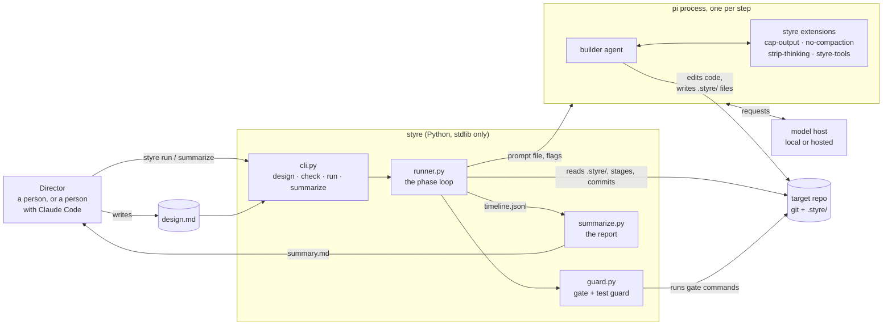
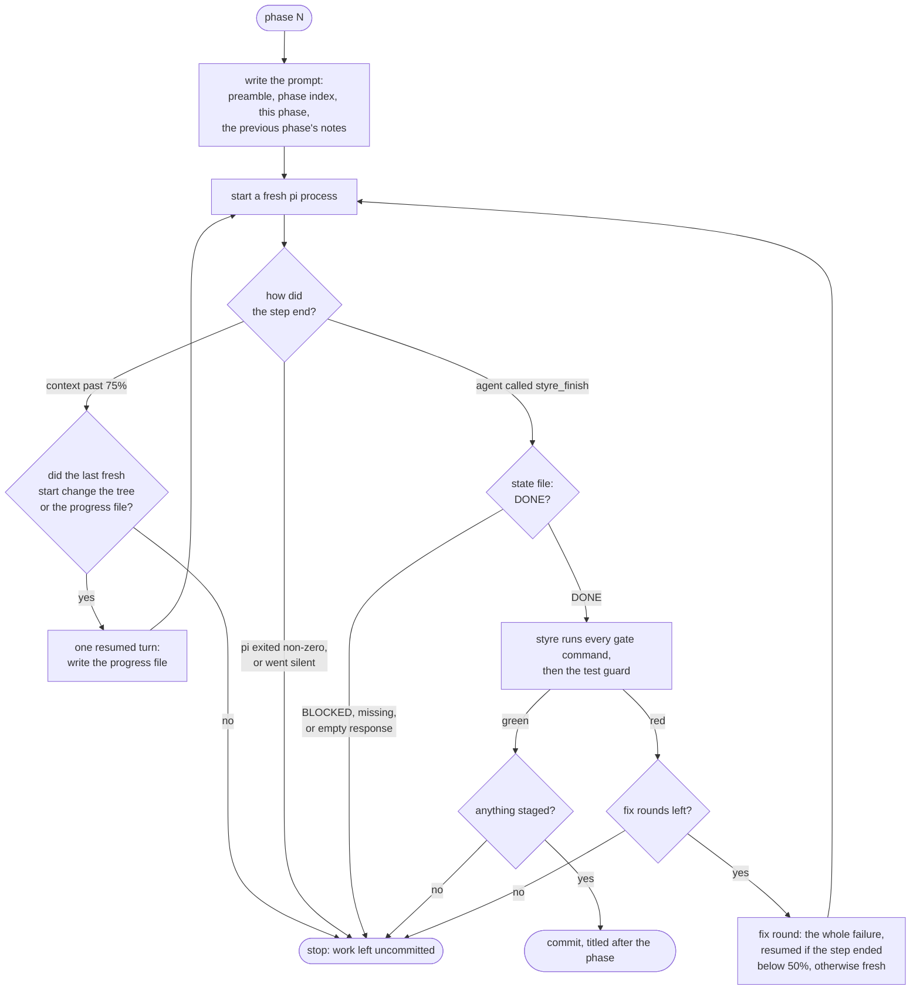
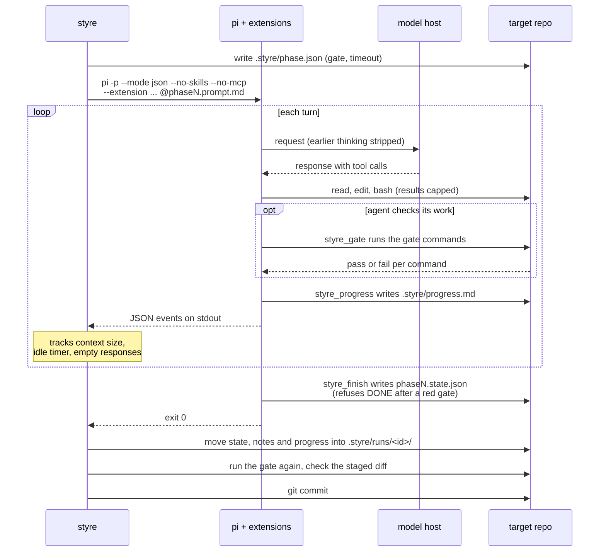
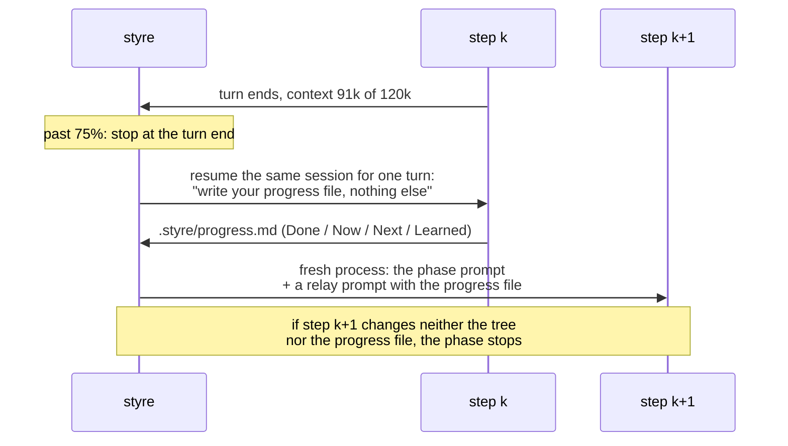

# Architecture

styre is a loop around pi. It reads a design, starts one pi process per step of a phase, runs
the gate itself, and commits. It calls no model and makes no network request of its own.
Everything it knows about a run is in files and git.

## The parts



The director and the model host are outside styre. The director makes every decision that
needs judgement: what the design says, what a stop means, whether the result is good. The
model host is wherever pi's config points.

## Modules

Each module has one job.

| Module | Job |
| --- | --- |
| `cli.py` | The `design`, `check`, `run` and `summarize` subcommands; `design` only opens interactive `claude` on `/styre-design` |
| `config.py` | Constants, the pi invocation, the context fractions, `RunOptions` |
| `design.py` | Parses a design into phases, validates it, and produces `check`'s warnings |
| `prompts.py` | Writes the phase prompt, the fix-round prompts, the handoff and the relay prompt |
| `agents.py` | The block styre writes into the target repository's `AGENTS.md` |
| `runner.py` | Preflight and the phase loop |
| `process.py` | Runs gate commands and git, streams pi's events, and kills a silent pi |
| `guard.py` | Runs the gate and checks the staged diff for test tampering |
| `gitops.py` | Every git call |
| `rundir.py` | Paths inside `.styre/runs/<id>/` |
| `state.py` | Reads and judges the agent's state file |
| `timeline.py` | Appends measured events to `timeline.jsonl` and flushes each line |
| `summarize.py` | Reads a run back from disk and writes `summary.md` |
| `pi_extensions/*.js` | Loaded into every pi process with `--extension` |

## One phase



A run is these phases in order. The first phase that stops ends the run, and
`--from-phase N` resumes it in the same run directory when the latest run used the same
design file.

## One step, in detail



The agent's own gate run and styre's are the same commands with the same timeout. Only
styre's run decides whether the phase is committed. `styre_finish` refusing DONE after a red
gate saves a step. It does not replace the check.

## Context management

On a local model host every token in the context costs prefill time and stays for the rest of
the step. styre follows three rules:

1. Keep tokens out at the source. `cap-output.js` limits a `read` to 300 lines and a `bash`
   result to its first 60 and last 90 lines. `strip-thinking.js` drops earlier thinking from
   each request.
2. Never rewrite the conversation, because that invalidates the prompt cache.
   `no-compaction.js` cancels pi's compaction.
3. When a step fills up, restart it from a file, not from a summary.



The fractions come from `contextWindow` in styre's pi config. A fix round below 50% of the
window resumes the failed step's session, which the model host still has cached. Above 50%,
the fix round starts a fresh process.

## What lives where

```
target repo/
  AGENTS.md                 styre's rules block, committed. pi loads it into every request.
  docs/decisions.md         the agent's log, append-only, committed, never read back to an agent
  .styre/                   excluded from git
    latest.txt              the most recent run
    phase.json              what styre_gate needs: the phase number, gate and timeout
    progress.md             the agent's working notes for the current phase
    notes-next.md           the agent's note to the next phase
    phaseN.state.json       written by styre_finish: DONE or BLOCKED, and why
    runs/<YYYYmmdd-HHMMSS>/
      phaseN.prompt.md, phaseN.fixR.md, phaseN.handoffK.md, phaseN.relayK.md
      phaseN.state.json, phaseN.notes-next.md, phaseN.progress.md
      logs/phaseN.log, logs/phaseN.events.jsonl
      sessions/phaseN/      pi's own sessions, used to resume a step
      timeline.jsonl        what styre did and when, measured by styre
      summary.md            the report
```

Each kind of handoff lasts as long as it needs to:

| File | Written by | Read by | Lasts |
| --- | --- | --- | --- |
| `progress.md` | the agent, through `styre_progress` | fresh starts and fix rounds of the same phase | one phase |
| `notes-next.md` | the agent | the next phase's prompt | one phase boundary |
| `docs/decisions.md` | the agent | people, in git | permanently, never sent to an agent |
| `phaseN.state.json` | `styre_finish` | styre, before it runs the gate | one step |
| `timeline.jsonl` | styre | `summarize` | permanently, per run |

## Why the agent's account is not trusted

The state file and the decisions log are the agent's own report. styre uses the state file
only to learn whether the agent says DONE or BLOCKED. Everything else that decides a phase
comes from styre's own measurements:

- styre runs the gate commands itself after the agent exits
- the test guard compares the staged diff for added skip or xfail markers and a net loss of
  test functions
- the timeline records durations, return codes, context sizes and commit hashes that styre
  measured
- `summary.md` is computed from the timeline

## pi runs isolated

Every pi process gets `PI_CODING_AGENT_DIR=~/.config/pi/styre`, so it does not load the
person's interactive extensions or `AGENTS.md`. `--no-skills` and `--no-mcp` turn off what pi
1.0 discovers on its own. stdin is closed, because `pi -p` reads a piped stdin to its end
before it starts. A pi process that prints nothing for `--timeout` seconds is killed with its
whole process group, so its children release ports and locks before the next step.
